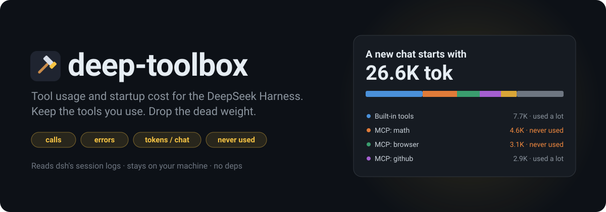
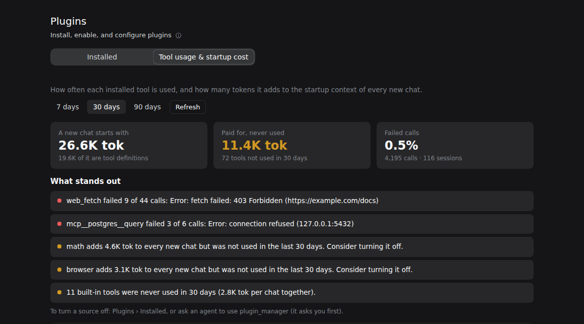

<p align="center">
  
</p>

<p align="center">
  <a href="https://www.npmjs.com/package/deep-toolbox"></a>
  <a href="https://www.npmjs.com/package/deep-toolbox"></a>
  
  <a href="https://github.com/JoblessJoe/deep-toolbox/blob/main/LICENSE"></a>
  <a href="https://github.com/topics/dsh-plugin"></a>
</p>

A [DeepSeek Harness](https://github.com/deepseek-ai/deepseek-harness) (dsh) plugin that shows **which tools your agents actually use, which ones fail, and what each one costs you in every request**. Every tool you install (built-in, plugin or MCP server) sends its full definition with every model request. A 37-tool MCP server can add thousands of tokens to each prompt, even if no agent ever calls it. deep-toolbox finds that dead weight so you can drop it.

```bash
npx @deepseek-ai/dsh plugin --profile web add deep-toolbox
```

Then restart your dsh web server and reload the tab. A **Tool usage & startup cost** tab appears on the Plugins page. Full details under [Install](#install).

<p align="center">
  
  <br><sub>Summary first: what a new chat starts with, what you pay for but never use, and which tools fail.</sub>
</p>

<p align="center">
  
  <br><sub>Everything a new chat carries before you type, and one row per tool source. Open a source for its per-tool table.</sub>
</p>

## What you see

- **A new chat starts with**: the tokens every new chat carries before you type, and how much of that is tool definitions.
- **Paid for, never used**: tools whose definitions go out with every request, but no agent called them in the chosen range.
- **Failed calls**: the error rate, with the latest error messages per tool.
- **What stands out**: plain-language tips, like "math adds 4.6K tok to every new chat but was not used in the last 30 days".
- **Startup context**: a chart of the built-in tools, each MCP server and plugin, each `AGENTS.md`, the system prompt and the skill list.
- **Tool sources**: one row per source, tagged *used a lot*, *rarely used* or *never used*. Open one for calls (main agent and subagents), errors, average time, result size, tokens per chat and last use of each tool.
- **Ranges**: last 7, 30 or 90 days. **Show removed** adds tools you used before but no longer have installed.

## For agents

Every agent gets a read-only `toolbox_report` tool with the same numbers as short text. An agent can notice "this MCP server costs 4.6K tok per chat and was never used" and offer to turn it off with dsh's built-in `plugin_manager`, which asks you first.

## How it works

No hooks, no database, no tracking code in the agent loop. dsh already records every tool call, result and request in its session logs (`~/.dsh/sessions/**/session.v*.jsonl.zstd`). deep-toolbox reads those logs when you open the tab and adds them up. Parsed files are cached until they change. Nothing leaves your machine.

- **Host**: one JSON route, `/api/deep-toolbox/stats`, plus the `toolbox_report` agent tool. It also notes which plugin registers which tool, so plugin tools don't count as built-in.
- **Client**: one self-contained bundle on dsh's own design tokens, so it looks native in both themes.

Token numbers are estimates (characters ÷ 4). "Sent" is the raw volume before prompt caching.

## Install

Into your dsh **web profile** (`web` below is the profile name; use whichever profile backs your web GUI). From a source checkout, use `pnpm dsh` instead of `npx @deepseek-ai/dsh`:

```bash
npx @deepseek-ai/dsh plugin --profile web add deep-toolbox
```

Restart the dsh web server afterwards, then reload the browser tab.

Other sources:

```bash
# straight from GitHub
npx @deepseek-ai/dsh plugin --profile web add github:JoblessJoe/deep-toolbox
# from a local checkout
npx @deepseek-ai/dsh plugin --profile web add file:/path/to/deep-toolbox
```

The agent tool also works in headless and TUI profiles. The tab needs the web GUI.

**Requirements**: dsh 0.2.2 or newer (`engines.dsh`: `>=0.2.2-rc.1 <0.4.0`), Node 22.15+ (built-in zstd).

## CLI

The same report in a terminal, or for an agent through `bash`:

```bash
npx deep-toolbox                       # last 30 days
npx deep-toolbox 7                     # last 7 days
npx deep-toolbox --errors web_fetch    # latest errors of one tool
npx deep-toolbox --json
npx deep-toolbox --agent               # the toolbox_report text
```

Set `DSH_HOME` (or `DSH_SESSIONS`) if your sessions are not under `~/.dsh`.

## Develop

```bash
npm install
npm run build   # lib/index.js (host) + lib/client.js (web) + lib/cli.js
npm test
```

## License

MIT
