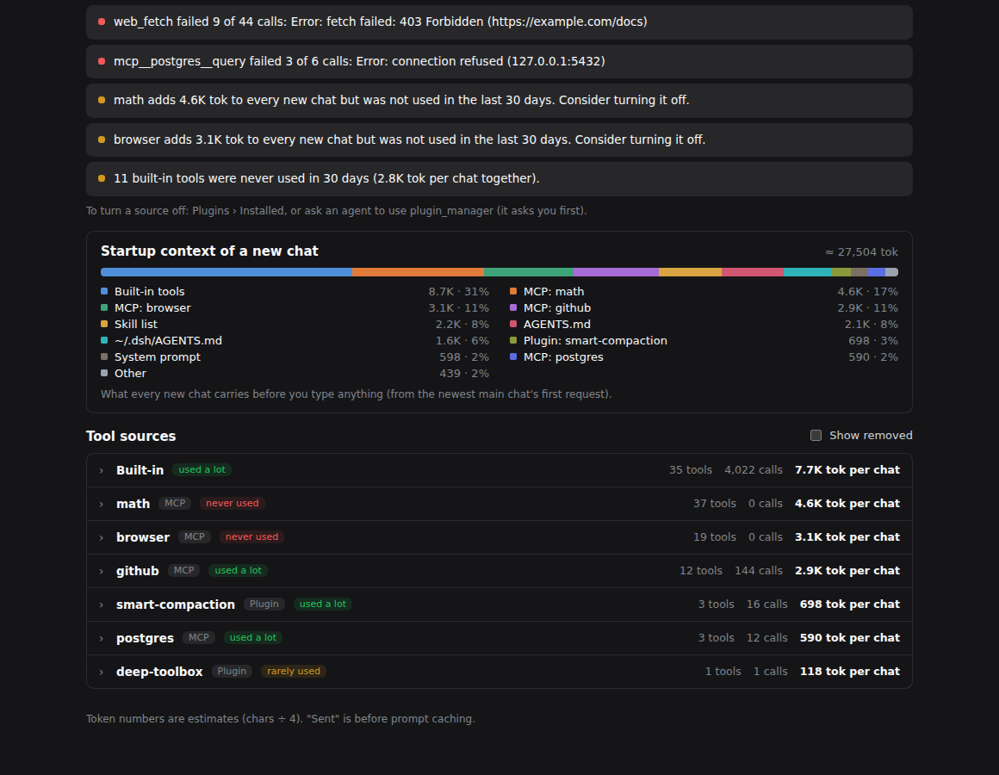

# deep-toolbox

**Which tools do your DeepSeek Harness agents actually use — and what does each one cost you in every request?**

Every tool you install (built-in, plugin or MCP server) sends its full definition with **every** model request. A 37-tool MCP server can add thousands of tokens to each prompt, even if your agents never call it. deep-toolbox shows you, per tool:

- **Calls** — main agent and subagents, over the last 7 / 30 / 90 days
- **Errors** — count, plus the latest error messages (click a row)
- **Avg time** and **result size**
- **Per-request cost** — tokens the tool's definition adds to every prompt
- **Never used** — tools you pay for in every request but nobody calls
- **Removed** — tools that were used before but are no longer configured


The page leads with a summary — what a new chat starts with, what you pay for but never use, which tools fail — and plain-language tips ("math adds 4.6k tok to every new chat but was not used in 30 days"). Below that:

- **Startup context** — a chart of everything a new chat carries before you type: built-in tools, each MCP server, each AGENTS.md file, the system prompt, the skill list.
- **Tool sources** — one row per source (built-in, each MCP server) tagged *used a lot / rarely used / never used*. Click a source for its per-tool table.



## For agents

deep-toolbox gives every agent a read-only `toolbox_report` tool with the same numbers as short text. An agent can notice "this MCP server costs 4.6k tok per chat and was never used" and offer to turn it off with dsh's built-in `plugin_manager`, which asks you first.

## How it works

No hooks, no database, no tracking code in the agent loop. dsh already records every tool call, result and request in its session logs (`~/.dsh/sessions/**/session.v*.jsonl.zstd`). deep-toolbox reads those logs on demand (files cache by mtime) and aggregates them. Nothing leaves your machine.

Token numbers are estimates (characters ÷ 4). "Sent" is the raw volume before prompt caching.

## Install

```bash
dsh plugin --profile web add deep-toolbox
```

Restart dsh. A **Tool usage & startup cost** tab appears on the Plugins page, next to Installed and Discover.

## CLI

The same report in a terminal — or for an agent via `bash`:

```bash
npx deep-toolbox            # last 30 days
npx deep-toolbox 7          # last 7 days
npx deep-toolbox --errors web_fetch
npx deep-toolbox --json
npx deep-toolbox --agent    # the toolbox_report text
```

Set `DSH_HOME` (or `DSH_SESSIONS`) if your sessions are not under `~/.dsh`.

## Requirements

- dsh `>=0.2.2-rc.1 <0.4.0`
- Node `>=22.15` (built-in zstd)

## License

MIT
